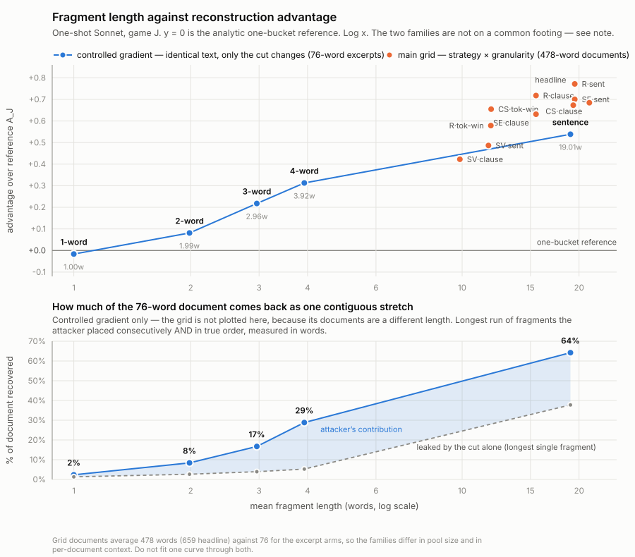

# Fragment length across every granularity tested

Measured from each cell's own `prose_fragments.jsonl`, not from the cut
specification. Advantage figures are One-shot Sonnet, game J, `A_J` per pool
then averaged. Regenerate with `python analysis/fig_fragment_length.py`.

## The arithmetic

### Main grid — four cutting strategies × three granularity labels

Full-length clinical documents, 478 words on average (659 for the headline cell).

| cell | granularity | words/frag | median | frags/doc | A_J |
|---|---|---|---|---|---|
| coherence-sever · clause | clause | 21.27 | 14.21 | 22.65 | +0.6845 |
| random · sentence | sentence | 19.50 | 13.96 | 24.56 | +0.7718 |
| semantic · sentence | sentence | 19.50 | 17.62 | 24.56 | +0.7004 |
| semantic · sentence (headline) | sentence | 19.33 | 17.61 | 34.09 | +0.6731 |
| random · clause | clause | 15.50 | 10.88 | 30.90 | +0.7178 |
| semantic · clause | clause | 15.50 | 13.46 | 30.90 | +0.6312 |
| coherence-sever · token-window | token-window | 11.88 | 12.00 | 40.22 | +0.6550 |
| random · token-window | token-window | 11.86 | 8.60 | 40.28 | +0.5788 |
| subject-verb · sentence | sentence | 11.69 | 9.33 | 40.94 | +0.4866 |
| subject-verb · clause | clause | 9.87 | 7.52 | 48.49 | +0.4225 |

Collapsed to the granularity label alone:

| granularity | cells | mean words/frag | range across cells | A_J range |
|---|---|---|---|---|
| sentence | 4 | 17.50 | 11.69 – 19.50 | +0.4866 to +0.7718 |
| clause | 4 | 15.53 | 9.87 – 21.27 | +0.4225 to +0.7178 |
| token-window | 2 | 11.87 | 11.86 – 11.88 | +0.5788 to +0.6550 |

### Controlled gradient — D16 + D18

The same 20 pools, the same 140 four-sentence excerpts, byte-identical text,
76 words per document. Only the cut width changes.

| arm | fragments | words/frag | median | sd | min | max | frags/doc | A_J |
|---|---|---|---|---|---|---|---|---|
| sentence | 560 | 19.01 | 17.0 | 9.64 | 1 | 62 | 4.00 | +0.5387 |
| 4-word | 2,714 | 3.92 | 4.0 | 0.42 | 1 | 4 | 19.39 | +0.3127 |
| 3-word | 3,596 | 2.96 | 3.0 | 0.25 | 1 | 3 | 25.69 | +0.2178 |
| 2-word | 5,360 | 1.99 | 2.0 | 0.12 | 1 | 2 | 38.29 | +0.0812 |
| 1-word | 10,646 | 1.00 | 1.0 | 0.00 | 1 | 1 | 76.04 | −0.0165 |

## Interpretation

**The whole main grid sits in the flat top of the curve.** Every grid cell has
fragments of at least 9.87 words. The gradient shows that advantage only starts
falling steeply below about four words — between the 4-word and 2-word arms the
slope is roughly 2.4× what it is on either side. So across its entire
granularity axis the main grid never reached the regime where fragment size
begins to matter. Varying "sentence vs clause vs token-window" moved mean
fragment length only from 17.50 to 11.87 words, a range over which the gradient
predicts almost no change. **This is the clearest single reason the D18 arms
were worth running: the grid could not have located the transition, because it
never entered it.**

**The granularity labels are not a clean variable.** They overlap heavily in
actual length: "clause" cells run 9.87 to 21.27 words, "sentence" cells 11.69
to 19.50. A coherence-sever clause fragment (21.27 words) is *longer* than any
sentence cell in the grid, and a subject-verb clause fragment (9.87) is shorter
than both token-window cells. Only token-window is tight, because it is defined
by a token count rather than by linguistic structure. Treat the grid's
granularity axis as a strategy-confounded proxy, not as a length axis.

**At matched length, the cutting strategy moves the result more than length
does.** Three pairs make this exactly:

| matched length | cells | A_J | gap |
|---|---|---|---|
| 15.50 words | random · clause vs semantic · clause | +0.7178 vs +0.6312 | 0.087 |
| 19.50 words | random · sentence vs semantic · sentence | +0.7718 vs +0.7004 | 0.071 |
| ~11.87 words | coherence-sever vs random token-window | +0.6550 vs +0.5788 | 0.076 |

Identical mean fragment length, 0.07–0.09 of advantage apart. Within the grid's
length range, *where* you cut matters more than *how small* the pieces are.

**The gradient is the only clean length experiment in the study.** Fragment
length variance collapses across its arms — sd 9.64 words at sentence, then
0.42, 0.25, 0.12, 0.00 — because the cut is defined by word count rather than
by linguistic boundaries. Text, pools, documents and prompt are all held fixed,
so length is the only thing moving, and advantage falls monotonically with it.

**The two families are not on a common footing.** Grid documents average 478
words against 76 for the excerpt arms, so a grid point and a gradient point at
the same x differ in how many fragments a pool holds and how much context each
document carries. At ~19 words the grid cells score +0.67 to +0.77 while the
gradient's sentence arm scores +0.54 — that gap is the document-length
difference, not a length effect. **Do not fit one curve through both**, and do
not read the chart as a single dose–response.

## Caveats

- `A_J` is measured against the analytic one-bucket reference, which the
  adjacency analysis showed overstates the floor by roughly 2× relative to a
  legal random seven-group answer (`docs/PRIOR_ART_CODE_COMPARISON.md` §4A).
  The ordering of cells is unaffected; the absolute heights would all rise
  against a size-blind random baseline.
- These are **id-level** scores. D16 froze the visible-text scorer as primary,
  and duplicate fragment text rises sharply at the fine end (0.5% at 4 words,
  5.4% at 2, 44.4% at 1). The 1-word point in particular is distorted: id-level
  `A_J` is −0.0165 while the visible `A_VJ` is +0.0161, opposite signs on the
  same answers. **The gradient series must be rebuilt on V_J/V_L with the
  permutation nulls before any granularity claim is published.**
- The gradient arms are post-hoc exploratory (D16, D18). One corpus, one model,
  one cut family. This locates where the advantage falls to the reference on
  the tested excerpts; it does not establish a safe fragment size.
